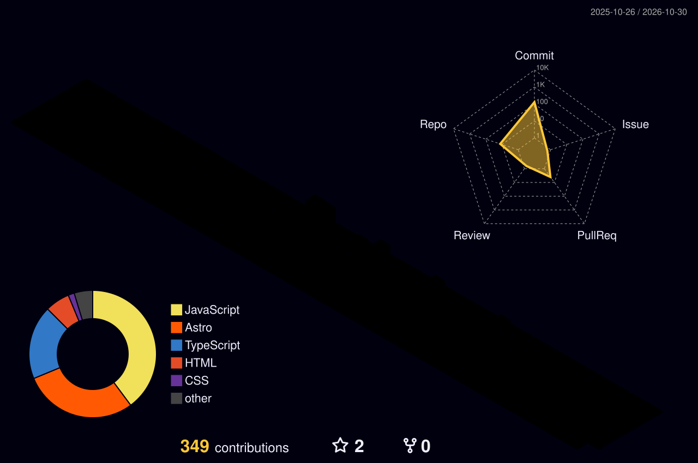

<h1 align="left">Hi! I'm Henrique, a Full Stack Freelancer </h1>

I'm a <b>Full Stack Developer & Freelancer</b> based in Figueira da Foz, Portugal 🇵🇹. I turn ideas into fast, accessible and maintainable digital products, without needing a whole team behind me.

I work mainly with <b>React / Next.js</b> and <b>Node.js / TypeScript</b>, and build mobile apps with <b>React Native</b>. I'm also very interested in cybersecurity and electronic hacking.

🟢 <b>Available for new remote projects</b>, usually replying within 24h.

  
  

##

  <h3><i>What I do</i></h3>
  <ul>
    <li><b>Web Development:</b> modern, fast and responsive sites and apps with React and Next.js</li>
    <li><b>Landing Pages:</b> optimized for conversion, SEO and performance</li>
    <li><b>Custom Platforms:</b> dashboards, management systems and B2B portals</li>
    <li><b>APIs & Integrations:</b> REST APIs, Stripe payments, email, authentication and webhooks</li>
    <li><b>Performance Optimization:</b> Lighthouse, Core Web Vitals, technical SEO and accessibility</li>
    <li><b>Maintenance & Support:</b> updates, fixes and new features for existing projects</li>
  </ul>

  <h3><i>Tech Stack</i></h3>
  
  
  
  
  
  
  
  
  
  
  
  
  

  <h3><i>Selected Projects</i></h3>
  <ul>
    <li><b><a href="https://github.com/henriqueolivgp/Real-Estate-API" target="_blank">Real Estate API</a></b>: REST API for the real estate sector, with solid business rules and efficient database management (Node.js, TypeScript)</li>
    <li><b><a href="https://triador-de-saude.vercel.app/" target="_blank">Triador de Saúde</a></b> (<a href="https://github.com/henriqueolivgp/Triador-de-Saude" target="_blank">code</a>): medical triage system that prioritizes patients by symptom severity (React, Node.js, TypeScript)</li>
    <li><b>Landing pages</b> built with Astro: <a href="https://landingpage-cake.pages.dev/" target="_blank">cake shop</a>, <a href="https://landingpage-cookies.pages.dev/" target="_blank">cookie shop</a> and <a href="https://gamingstore-217.pages.dev/" target="_blank">game store</a></li>
  </ul>
  
More at <a href="https://www.henriqueoliv.pt/" target="_blank">henriqueoliv.pt</a>.

  <h3><i>Social Networks</i></h3>
  

  
  
  

  <h3><i>Favorite Operating Systems</i></h3>
  
  
  

<picture>
  <source media="(prefers-color-scheme: dark)" srcset="https://github.com/henriqueolivgp/henriqueolivgp/blob/output/github-contribution-grid-snake-dark.svg">
  <source media="(prefers-color-scheme: light)" srcset="https://github.com/henriqueolivgp/henriqueolivgp/blob/output/github-contribution-grid-snake.svg">
  
</picture>
